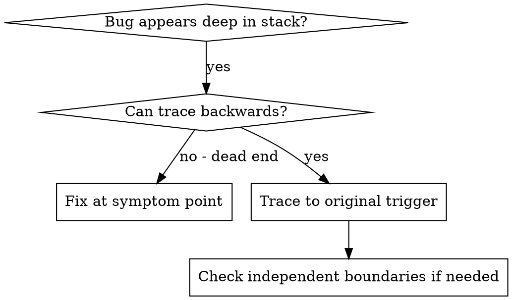
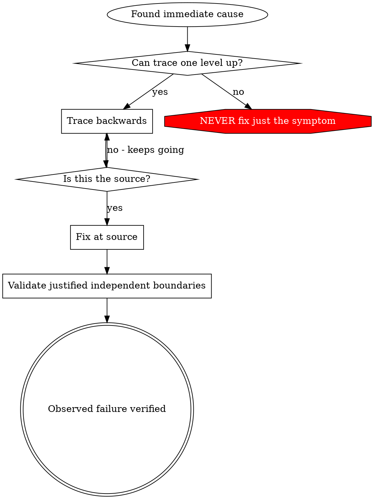

# Root Cause Tracing

## Overview

Bugs often manifest deep in the call stack (git init in wrong directory, file created in wrong location, database opened with wrong path). Your instinct is to fix where the error appears, but that's treating a symptom.

**Core principle:** Trace backward through the call chain until you find the original trigger, then fix at the source.

## When to Use



**Use when:**

- Error happens deep in execution (not at entry point)
- Stack trace shows long call chain
- Unclear where invalid data originated
- Need to find which test/code triggers the problem

## The Tracing Process

### 1. Observe the Symptom

```
Error: git init failed in /Users/jesse/project/packages/core
```

### 2. Find Immediate Cause

**What code directly causes this?**

```typescript
await execFileAsync("git", ["init"], { cwd: projectDir });
```

### 3. Ask: What Called This?

```typescript
WorktreeManager.createSessionWorktree(projectDir, sessionId)
  → called by Session.initializeWorkspace()
  → called by Session.create()
  → called by test at Project.create()
```

### 4. Keep Tracing Up

**What value was passed?**

- `projectDir = ''` (empty string!)
- Empty string as `cwd` resolves to `process.cwd()`
- That's the source code directory!

### 5. Find Original Trigger

**Where did empty string come from?**

```typescript
const context = setupCoreTest(); // Returns { tempDir: '' }
Project.create("name", context.tempDir); // Accessed before beforeEach!
```

## Adding Stack Traces

When you can't trace manually, add instrumentation:

```typescript
// Before the problematic operation
async function gitInit(directory: string) {
  const stack = new Error().stack;
  console.error("DEBUG git init:", {
    directory,
    cwd: process.cwd(),
    nodeEnv: process.env.NODE_ENV,
    stack,
  });

  await execFileAsync("git", ["init"], { cwd: directory });
}
```

Use a diagnostic channel the current runner captures; confirm the output is visible. Remove temporary instrumentation after verification.

**Run and capture:**

```bash
npm test 2>&1 | grep 'DEBUG git init'
```

**Analyze stack traces:**

- Look for test file names
- Find the line number triggering the call
- Identify the pattern (same test? same parameter?)

## Finding Which Test Causes Pollution

If something appears during tests but you don't know which test:

Use [find-polluter.sh](../scripts/find-polluter.sh) when the symptom is a newly created file or directory. Resolve `<skill-dir>` from the installed skill and run from a disposable project copy using the project's actual test-selection command:

```bash
bash <skill-dir>/scripts/find-polluter.sh 'unexpected-output' './tests/*.test.js' -- npm test --
```

The command and arguments after `--` are executed directly, with each selected test path appended as one argument. The npm invocation above is an example, not a required runner. Use a maintained wrapper when the project's selector requires a different argument layout; no shell expression is evaluated.

This helper **runs mutating test commands**. Confirm that the command really executes the supplied file; a runner that ignores selection cannot identify a polluter. Run without concurrent writers, starting with the target absent. The helper does not delete project state, isolate each test, or prove causality: earlier tests may influence a later one. It visits matching files in filesystem traversal order and stops at the first observed contamination. Reproduce that candidate independently before blaming it.

Exit `0` means no contamination was observed in the successful selected run; `1` means contamination was observed (the command's exit is also reported); `2` means invalid or incomplete investigation, including an empty selection, pre-existing target, discovery failure, or failed command without contamination. Interruption is not a clean result. Inspect command output and use a fresh disposable copy before retrying.

## Real Example: Empty projectDir

**Symptom:** `.git` created in `packages/core/` (source code)

**Trace chain:**

1. `git init` runs in `process.cwd()` ← empty cwd parameter
2. WorktreeManager called with empty projectDir
3. Session.create() passed empty string
4. Test accessed `context.tempDir` before beforeEach
5. setupCoreTest() returns `{ tempDir: '' }` initially

**Root cause:** Top-level variable initialization accessing empty value

**Fix:** Made tempDir a getter that throws if accessed before beforeEach

**Possible independent guards to evaluate, not a mandatory checklist:**

- Layer 1: Project.create() validates directory
- Layer 2: WorkspaceManager validates not empty
- Layer 3: NODE_ENV guard refuses git init outside tmpdir
- Layer 4: Stack trace logging before git init

## Key Principle



**Fix the established cause.** Trace back to find the original trigger when the evidence does not yet establish it.

## Stack Trace Tips

**In tests:** Use a captured diagnostic channel and verify its output is visible
**Before operation:** Log before the dangerous operation, not after it fails
**Include context:** Relevant paths and timestamps; redact secrets and avoid dumping environments
**Capture stack:** `new Error().stack` shows complete call chain
